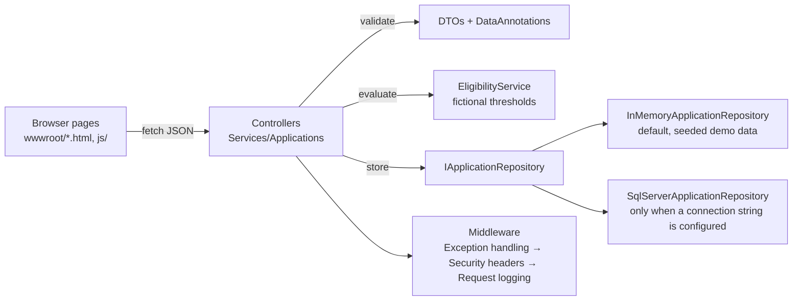

# Architecture

## Diagram



## Layers (one project, clean boundaries, for portability)

| Layer | Files | Responsibility |
|---|---|---|
| Controllers | `Controllers/Controllers.cs` | HTTP only: routes, status codes, response shapes |
| Services | `Services/Services.cs` | Catalogue, eligibility rule, application orchestration, reference numbering |
| Repositories | `Repositories/Repositories.cs` | Storage behind an interface; in-memory default, SQL Server option |
| DTOs / Models | `Dtos/`, `Models/` | Request validation (DataAnnotations) and stored shapes |
| Middleware | `Middleware/Middleware.cs` | Generic errors, security headers, request logging (no bodies/PII) |

A larger enterprise system would split these into separate
projects (Domain, Application, Infrastructure, Web); keeping them
as folders here is a deliberate portability choice for a code
sample that must build with one `dotnet build`.

## API contract

| Method & path | Success | Failure |
|---|---|---|
| `GET /api/services` (also `/api/v1/services`) | 200, fictional catalogue | — |
| `GET /api/services/{id}` | 200, one service | 404 `{error}` |
| `POST /api/applications` | 201 + `Location`, body: `reference`, `status`, `eligibilityOutcome`, `eligibilityReasons`, `serviceIds`, `city`, `zipCode`, `householdSize`, `submittedAtUtc` | 400 field errors (model validation) or `{errors}` (business rules) |
| `GET /api/applications/{reference}` | 200, application (demo fields only) | 404 `{error}` |
| `GET /health` | 200 `{status:"ok", demo:true}` | — |

Request example (fictional):

```json
{
  "firstName": "Alex", "lastName": "Example", "city": "Des Moines",
  "zipCode": "50309", "householdSize": 3, "monthlyIncome": 1500,
  "serviceIds": ["food-assistance"], "consent": true
}
```

## Decisions and trade-offs

- **No EF Core in the demo:** the SQL repository uses ADO.NET
  with parameters, which shows the SQL itself — the skill the
  posting weights — without hiding it behind an ORM. EF Core is
  on the author's resume and would be a natural production choice.
- **No front-end framework in the demo pages:** plain HTML/CSS/JS
  keeps the accessibility behaviour inspectable and the app
  runnable with no build step. Angular (on the resume) would be
  the right choice for a large multi-team app; adding a token
  Angular app here would be keyword-matching, not evidence.
- **In-memory default store:** the demo runs with zero setup.
  SQL Server is one registration away and fully documented.
- **No authentication in the demo:** a public demo with fictional
  data has nothing to protect. A real system would use Entra ID /
  OpenID Connect, RBAC and audit logging (all on the resume).
